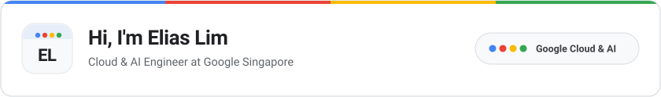

<picture>
  <source media="(prefers-color-scheme: dark)" srcset="./assets/header-dark.svg" />
  <source media="(prefers-color-scheme: light)" srcset="./assets/header-light.svg" />
  
</picture>

I am a Cloud & AI Engineer at Google in Singapore. I enjoy building zero-trust cloud architectures, high-scale backend services, autonomous agent observability tools ([Antigravity Agent Tracer](https://github.com/elim316/Antigravity-Agent-Tracer-Plugin), 1st Place at Google's AI Agent Lab Hackathon 2026), and uncertainty-aware machine learning systems.

Portfolio website: [elim316.github.io](https://elim316.github.io) | Live demos: [Agent Tracer](https://elim316.github.io/sandbox/agent-tracer/) / [Meeting Prep Agent](https://elim316.github.io/sandbox/meeting-prep/) / [UQ-XAI Battery Analytics](https://elim316.github.io/sandbox/uq-battery/)

Google Scholar: [Publications](https://scholar.google.com/citations?user=f2hfYeoAAAAJ&hl=en) (IEEE Xplore: [APSIPA ASC 2025](https://ieeexplore.ieee.org/document/11249263), [IEEE FIE 2025](https://ieeexplore.ieee.org/document/10892827))
